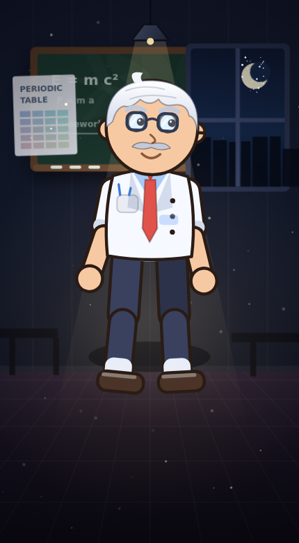
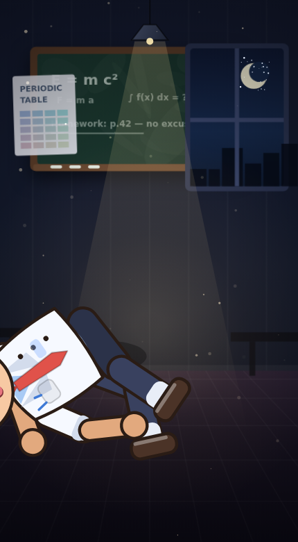
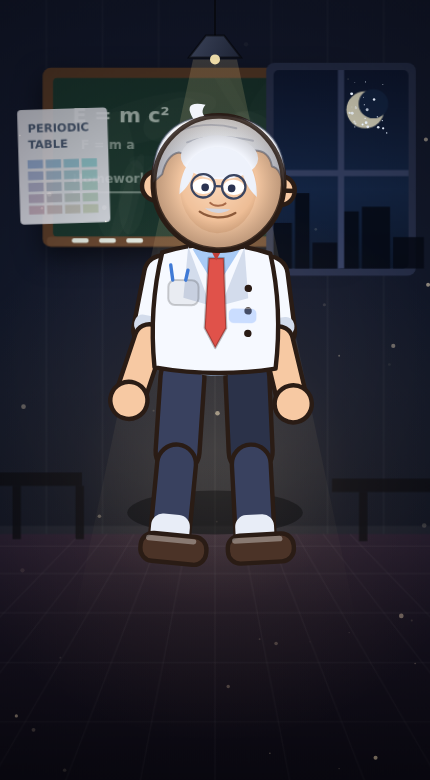

# 🥊 Kick the Professor

A professional, physics-based **“kick the buddy”** game that runs as a **Telegram Mini App**.
The Professor kept you after class — now it's payback. Kick, punch and swing nine
weapons, wreck his HP, chain combos, farm coins, upgrade your gear and climb a
global leaderboard. And yes: **you can swap his face, the whole background and the
voice** — from inside the game (Studio) or by dropping files into `web/assets/`.

<p align="center">
  
  
  
  
</p>

---

## Highlights

| Area | What you get |
| --- | --- |
| **Gameplay** | Spring-driven ragdoll with per-limb physics, 9 weapons (kick → chalk bomb), critical hits, combo multiplier, stun, rage mode, K.O. animations, screen shake, hit-stop |
| **Progression** | Coins per damage + K.O. bonus, 4 permanent upgrade tracks (power, crit, coin bonus, toughness), weapon unlocks, persistent save (localStorage + Telegram CloudStorage) |
| **Customisation** | Face swap (cartoon, drop-in photos or in-app upload), background swap (drawn classroom, drop-in images or upload), full-body doll replacement, voice selection (4 built-in cartoon voices, drop-in voice packs, or record your own per event) |
| **Telegram** | Verified `initData`, Mini App button + menu button, webhook **and** long-polling modes, haptics, cloud save, native share, bot commands (`/play /top /me /help`) in EN/AR/DE/ES |
| **Backend** | Zero-dependency Node HTTP server, SQLite leaderboard (global + weekly), anti-spam score endpoint, per-player rank, manifest auto-scan for assets, gzip + ETag static serving |
| **Quality** | Fully responsive + RTL, reduced-motion option, no external game assets (all art & SFX generated in code), headless smoke test |

---

## Quick start

```bash
npm install          # only dev deps (jsdom, @napi-rs/canvas) — runtime has zero deps
npm start            # → http://localhost:8080
```

Open the URL in a browser: the game runs in **preview mode** (no bot required,
leaderboard uses a throwaway guest identity, everything else works).

### Connect it to Telegram

1. **Create a bot** with [@BotFather](https://t.me/BotFather) → `/newbot`.
2. **Expose the server over HTTPS.** Telegram Mini Apps must be served from HTTPS.
   For local work use a tunnel (`ngrok http 8080`, `cloudflared tunnel --url …`).
3. **Configure:**

   ```bash
   cp .env.example .env
   # BOT_TOKEN=123456:ABC…
   # PUBLIC_URL=https://your-tunnel-or-domain
   # WEBHOOK_SECRET=<random hex>
   npm start
   ```

   On boot the server registers the webhook and points the bot's **menu button**
   at the Mini App. `npm run bot:setup` additionally sets the bot description and
   the `/play /top /me /help` command list.

4. **Make it the Mini App:** BotFather → `/setmenubutton` (or let the server do it),
   then tap the button in the chat. Alternatively use a direct Mini App link:
   `https://t.me/<bot>/<app-name>` or `https://t.me/<bot>?startapp=play`.

> No public URL? Set `USE_POLLING=1` to drive the bot through `getUpdates`
> instead of a webhook (the Mini App itself still needs HTTPS).

Full deployment notes: **[docs/DEPLOY.md](docs/DEPLOY.md)**.

---

## Changing the doll, the background and the voice

Two ways — pick whichever suits you:

### 1. In the game (no files, works on a phone)

Open **🎨 Studio**:

* **Face** — pick a bundled face, upload a photo, done. The professor's head is
  cropped to an ellipse so any picture fits; tweak with the JSON metadata if needed.
* **Background** — pick a stage or upload your own picture.
* **Doll** — replace the whole drawn body with a full-body cut-out image.
* **Voice** — choose a built-in cartoon voice, an installed voice pack, or hit
  **Record** on any event (hit / ouch / K.O. / taunt / special / coin) and speak
  your own line. Recordings are stored in IndexedDB and play instantly.

### 2. Drop-in files (for shipping content to everyone)

```
web/assets/backgrounds/<id>.jpg     → appears in Studio ▸ Background
web/assets/faces/<id>.png           → appears in Studio ▸ Face
web/assets/dolls/<id>.png           → appears in Studio ▸ Doll
web/assets/voice/<pack>/hit-1.mp3   → appears in Studio ▸ Voice as a pack
```

Restart the server (or `npm run assets`) and the manifest is rescanned.
Faces and dolls look best as transparent PNGs; a sample face ships in
`web/assets/faces/dean.svg`.

Details, tuning keys and the voice-event naming rules: **[docs/ASSETS.md](docs/ASSETS.md)**.

---

## Playing

* **Tap / drag on the Professor** — swing the selected weapon where you touch.
* **Weapon dock** — tap an owned weapon to equip it; locked ones open the Shop.
* **Keyboard** (desktop) — `1…9` switch weapons, `Space` attack.
* **Combo** — every hit inside 2.1 s raises the multiplier (up to ×1.8) and the
  damage bonus.
* **Rage** — fills with hits; at 100% you get 8 s of double damage and faster
  swings.
* **K.O.** — drain the HP bar; the round ends with confetti, a coin bonus and the
  next round starts with tougher-but-richer rewards.

Coins come from damage dealt (`damage / 12`, scaled by the coin upgrade),
from K.O. bonuses, and every weapon/upgrade purchase is permanent.

---

## Project layout

```
server/                 zero-dependency Node backend (ESM)
  index.js              HTTP server, routing, boot logs
  api.js                /api/* + Telegram webhook
  telegram.js           Bot API client, commands, webhook/menu setup, polling
  validation.js         initData HMAC verification
  assets.js             asset folder scanner + manifest
  db.js                 SQLite (node:sqlite) players/rounds/leaderboard
  static.js             static files, gzip, ETag, CSP for Telegram WebView

web/                    the Mini App (vanilla ES modules, no build step)
  index.html, styles.css
  js/main.js            bootstrap + wiring
  js/game.js            loop, input, combat maths, rendering
  js/doll.js            spring-driven articulated character renderer
  js/background.js      painted classroom + uploaded images + parallax
  js/effects.js         particles, damage numbers, shockwaves
  js/audio.js           procedural SFX, synth voice, music, voice packs
  js/voicebox.js        mic recorder + IndexedDB clip storage
  js/content.js         weapons, upgrades, voices, reward maths
  js/store.js           save data, coins, unlocks, cosmetics, settings
  js/studio.js          face/background/doll/voice UI
  js/shop.js, board.js, settings.js, ui.js, i18n.js, assets.js, telegram.js
  assets/               drop-in backgrounds, faces, dolls, voice packs

scripts/                asset manifest, bot setup, PNG preview renderer
tests/                  headless smoke test (jsdom)
docs/                   asset guide, deployment guide, previews
```

### HTTP API

| Method | Path | Purpose |
| --- | --- | --- |
| `GET` | `/api/health` | liveness + bot status |
| `GET` | `/api/config` | demo mode, start coins, **asset manifest** |
| `POST` | `/api/session` | verify `initData`, upsert player, return rank |
| `POST` | `/api/score` | record a round (HMAC-verified, rate-limited) |
| `GET` | `/api/leaderboard?period=all\|week&limit=20` | rankings |
| `GET` | `/api/stats` | global totals |
| `POST` | `/telegram/webhook/:secret` | Telegram updates |

Scores are tied to a verified Telegram user; the client sends
`X-Telegram-Init-Data` on every call.

---

## Development

```bash
npm start                 # production-ish server
npm run dev               # same, with --watch
npm test                  # headless smoke test (boots the client in jsdom)
npm run assets            # rescan web/assets → manifest.json
node scripts/render-preview.mjs   # render docs PNGs (needs @napi-rs/canvas)
```

`npm test` boots the entire client with a stub canvas/audio layer and asserts
that attacks connect, the K.O. → next-round flow works and every sheet
(Shop, Studio, Settings, Leaderboard) renders without runtime errors.

---

## Notes & limitations

* Assets uploaded in the Studio are stored **on that device** (localStorage /
  IndexedDB). Use the drop-in folders to distribute art to every player.
* The built-in voice is synthesised in the browser (no TTS service) — it sounds
  like a cartoon mumble, deliberately. For realistic lines use an uploaded voice
  pack or the in-game recorder.
* Preview mode (no `BOT_TOKEN`) never writes to the leaderboard — by design.

## License

MIT.
